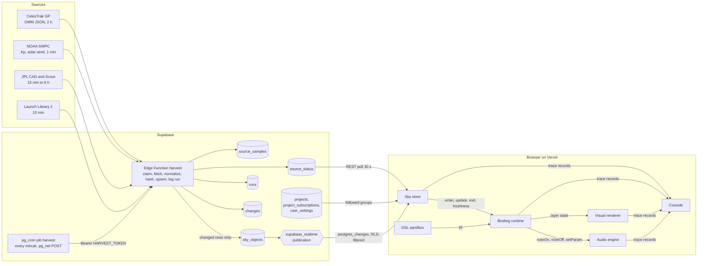

# Architecture

## Scope
Components, their jobs and interfaces, the data-flow chart, and the path of one change from a source to the speakers and screen.

## Data flow

## Components
| Component | Job | Input | Output | Error contract |
|---|---|---|---|---|
| Cron trigger | Invokes the worker once a minute | `cron.job` `harvest` | HTTP POST | Failed POST: logged in `net._http_response`; next minute retries |
| Source registry | Declares each source's endpoint, schedule, normalizer and failure policy | `supabase/functions/harvest/sources.json` | Validated entries | Invalid entry: HTTP 500 naming the entry; nothing runs |
| Scheduler | Selects and claims due sources, one request per host at a time | Registry, `source_status` | Jobs | Entry claimed by an overlapping invocation: skipped |
| Fetcher | Performs one HTTP GET with User-Agent and timeout | URL | Body, status | Non-200 or timeout: `FetchError` |
| Normalizer | Converts one raw body into sky objects | Body | `SkyObject[]` | Malformed body: `NormalizeError` |
| Upserter | Writes changed objects and their diffs | `SkyObject[]` | `changes` rows | RPC error: run fails |
| Run logger | Records each run | Run result | `runs`, `source_status` | Write error: logged to stderr |
| Sky store | Holds followed objects and source freshness; emits events | Realtime, REST | `SkyEvent` stream | Channel error: sources show `down` |
| DSL sandbox | Removes TypeScript syntax, runs the script and returns IR | Script text | IR, problems | Timeout after 1500 ms: problem `timeout` |
| Type checker | Type-checks the script in the editor | Script text, `builder.d.ts` | Diagnostics, completions, hover text | Diagnostics are warnings; never blocks Run |
| IR validator | Accepts or rejects IR | IR | Problems list | Any error blocks Run and Save |
| Expression interpreter | Evaluates expression nodes | Node, object, context | Number, string or boolean | Non-finite result: `null` |
| Binding runtime | Turns sky events into instrument calls and layer state | IR, `SkyEvent` | Engine calls, layer props | Over-limit events: dropped and traced |
| Audio host | Starts the engine and syncs IR instruments to it | IR instruments | `Engine.sync(widgets)` | Engine fault: Run stops, UI shows error |
| Visual renderer | Draws layers | Layer state, positions | Frames | No WebGL2: 2D summary |
| SGP4 worker | Propagates orbital elements | OMM fields | Positions at 2 Hz | Failed object: omitted, traced |
| Trace bus | Collects structured records from every stage | Records | Ring buffer, JSONL export | Full buffer: oldest record dropped |

## Interfaces between halves
- The worker and the page share only the database schema (`database.md`).
- The page's data side and sound side share only the sky contract (`sky-contract.md`) and the instrument contracts (`bindings.md`).
- Scripts share only the builder API. The sandbox returns data; no script code runs during playback.

## Trace of one change
1. **SOURCE.** The cron job invokes the Edge Function. The scheduler claims `swpc.wind`. The fetcher receives HTTP 200.
2. **NORMALIZE.** The normalizer strips trailing NUL bytes, selects the newest row with `active: true`, maps `-9999` to `null`, and emits `{ id: "swpc.wind:l1", group: "swpc.wind", fields: { speed: 512.3, density: 4.1, temperature: 91000, spacecraft: "...", timeTag: "..." } }`.
3. **CHANGE.** The upserter computes `hash = sha256(canonicalJson(fields))` and calls `upsert_sky_objects`. The RPC updates the row because the hash differs and inserts a `changes` row with a `trace_id`.
4. **RUN.** The run logger inserts `runs { ok: true, rows_changed: 1 }` and updates `source_status`.
5. **REALTIME.** Supabase sends an `UPDATE` to every subscriber whose filter includes `swpc.wind` and whose RLS check passes.
6. **BIND.** The sky store emits `update`. A param binding evaluates `sky.swpc('wind.speed').map(300, 800, 300, 4000, 'log')` and calls `setParam('cutoff', 1220.4)` on the target instrument.
7. **AUDIO.** The trace records the requested value and the value after `coerceParam`.
8. **VISUAL.** An `aurora` layer bound to the same field updates its drift.

Every record from steps 3–8 carries the same `trace_id`. The console groups them into one chain.

## Sources
- Supabase docs, Postgres Changes: https://supabase.com/docs/guides/realtime/postgres-changes
- NOAA SWPC, Real-Time Solar Wind: https://www.swpc.noaa.gov/products/real-time-solar-wind
